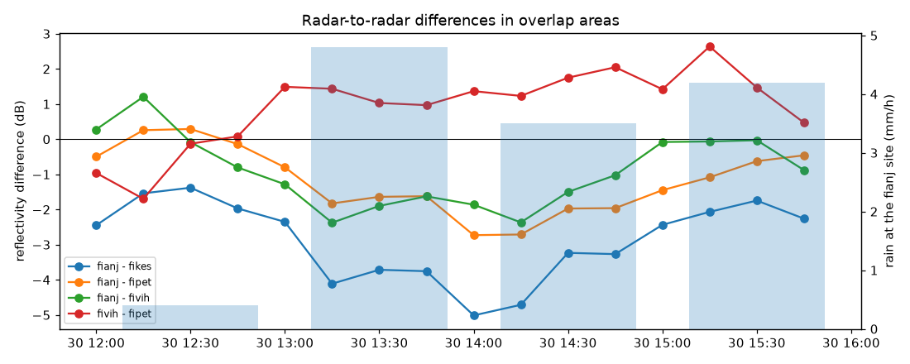
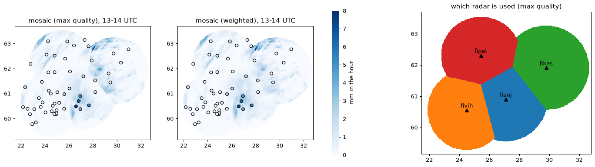
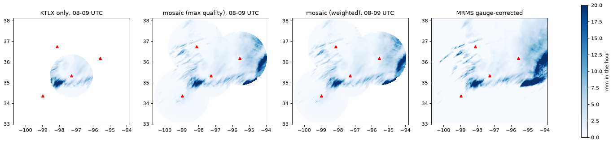

# radarwow-mosaic

**radar-wow stage 8: Compositing, mosaics and accumulation.** Multi-radar mosaics, advection-corrected accumulation; national systems as references.

Part of [radar-wow](https://github.com/manmeet3591/radar-wow), a set of repos that together build a radar QPE system that works for S, C and X band radars.
Every algorithm is one class implementing one paper, with the same interface: it takes an xradar sweep or volume with canonical moment names, declares the bands and moments it needs, and records provenance.

## Sub-components

| sub-component | algorithm | source | DOI | status |
|---|---|---|---|---|
| Swiss operational chain | reference design | Germann et al. 2022, Remote Sens. | [doi:10.3390/rs14030503](https://doi.org/10.3390/rs14030503) | to review |
| MRMS, KMA, KNMI, UK, JMA, RADOLAN, CMPAS | reference designs | talk + review (Zhang et al. 2025, Remote Sens.) | [doi:10.3390/rs17213619](https://doi.org/10.3390/rs17213619) | to review |
| quality-weighted and max-quality composite | `mosaic_hourly`, `composite`, `quality_index` | Michelson et al. 2018 (BALTRAD); Zhang, Howard & Gourley 2005 | [doi:10.5334/jors.193](https://doi.org/10.5334/jors.193) | implemented + notebook |
| radar-to-radar reflectivity comparison | `overlap_difference` | overlap cells at similar beam height |  | implemented + notebook |
| accumulation | `AdvectionAccumulation` | motion-corrected sums |  | planned |

## Install

```bash
pip install git+https://github.com/manmeet3591/radarwow-core git+https://github.com/manmeet3591/radarwow-mosaic
```

## Notebooks (free data, S / C / X band)

- [`notebooks/01_finland_mosaic.ipynb`](notebooks/01_finland_mosaic.ipynb): open in Colab via `https://colab.research.google.com/github/manmeet3591/radarwow-mosaic/blob/main/notebooks/01_finland_mosaic.ipynb`
- [`notebooks/02_oklahoma_mosaic.ipynb`](notebooks/02_oklahoma_mosaic.ipynb): open in Colab via `https://colab.research.google.com/github/manmeet3591/radarwow-mosaic/blob/main/notebooks/02_oklahoma_mosaic.ipynb`

## Results





## Usage

```python
from radarwow.core import load_sample
from radarwow.mosaic import *  # see table above

vol = load_sample('arm_csapr2_c')        # or open_volume('my_file')
# out = SomeAlgorithm()(vol)            # band read from the file, or band='S'|'C'|'X'
```

## Status legend

*implemented + notebook*: code, tests, executed notebook. *planned*: interface fixed, code to write. *stub*: class exists, raises `NotImplementedError`. *to review*: paper to read before deciding.

## License

MIT. Data used in the notebooks comes from public archives (NEXRAD on AWS, ARM, IMD via open-radar-data) under their own terms.
